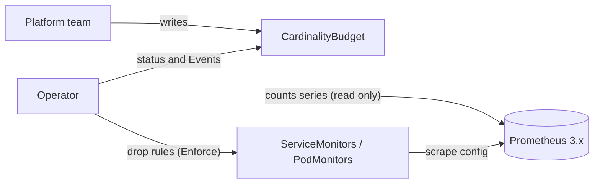

# CardinalityBudget operator

Per-namespace Prometheus series budgets for Kubernetes: measure each namespace's active series, show usage on a
`CardinalityBudget` resource, and, when asked, cut the biggest metrics gradually and reversibly through the
namespace's own ServiceMonitors and PodMonitors.

> **Status: alpha (v0.3), v1.0 in progress.** Observe, Warn and Enforce modes work and are tested in CI. Enforce deletes data on
> purpose, so run v0.x on lab clusters only. Production readiness is the v1.0 goal. No images are published
> yet; build your own (see [Install](#install)).

```console
$ kubectl get cb -A
NAMESPACE   NAME      PHASE      SERIES   LIMIT   USAGE %   MODE      AGE
checkout    default   Healthy    41210    60000   68        Enforce   12d
demo        default   Enforcing  1006     900     111       Enforce   3h
search      default   Warning    9350     10000   93        Warn      5d
```

## Why

Prometheus memory and cost grow with the number of active series. One new label such as `user_id` can add
hundreds of thousands of series in minutes and slow down a Prometheus that every team shares. CardinalityBudget
gives each namespace a visible limit, tells the team before it is reached, and can stop the growth without
anyone being paged at night.

## How it works



- One budget per namespace, always named `default`, owned by the platform team. Teams can read it.
- Every `--measure-interval` (5m) the operator counts the namespace's series in Prometheus, leaving out cluster
  exporters and recording rules, and lists the top 10 metrics.
- A measurement is trusted only if Prometheus is ready, warmed up, fresh and returned no warnings. Otherwise the
  phase is `Unknown` and nothing is changed.
- The operator never sits in the data path. To enforce, it appends a standard drop rule
  (`action: drop` on `__name__`) to the namespace's monitors and marks it as its own.

| Mode | Behaviour |
| --- | --- |
| `Observe` (default) | Status (phase, series, usage, top metrics), conditions, one Event per state change |
| `Warn` | Observe, plus `plannedDrops`: what Enforce would drop next |
| `Enforce` | Warn, plus drop rules after `gracePeriod`, one step per settle period; restores when usage goes down |

## Example

```yaml
apiVersion: cardinality.telemetry-compass.com/v1beta1
kind: CardinalityBudget
metadata:
  name: default
  namespace: team-a
spec:
  maxActiveSeries: 50000
  warnThresholdPercent: 90        # Warning phase from here
  mode: Warn                      # Observe | Warn | Enforce
  enforcement:
    gracePeriod: 30m              # over budget this long before the first drop
    maxMetricsToDrop: 1           # per step
    maxTotalDrops: 5              # in total
    protectedMetrics: ["up", "http_requests_total"]   # never dropped (anchored regexes)
    monitorSelector: {}           # empty = every monitor in the namespace
```

`kubectl describe cb default -n team-a` shows the conditions (`Ready`, `BackendReachable`, `BudgetExceeded`,
`Enforced`), `topMetrics`, `plannedDrops`, `enforcedDrops` and the Events.

## Safety in Enforce mode

| Guard | Effect |
| --- | --- |
| Grace and settle periods | First drop only after `gracePeriod` over budget; `--enforcement-settle-period` (10m) between steps |
| Caps | `maxMetricsToDrop` per step, `maxTotalDrops` per budget, `--max-drops-per-hour` (10) across all budgets |
| Protected metrics | `protectedMetrics` and recording rules (names with `:`) are never dropped |
| Checks after each drop | Prometheus must reload, and at least 90% of the metric's series must disappear; otherwise the budget pauses |
| Drift | A removed or changed drop rule pauses the budget; the operator never re-applies it |
| Team rules | Never touched; only rules recorded in the operator's annotation are removed |
| Invalid measurement | No rule is added **or** removed |
| Undo | Below the warn threshold, when leaving Enforce, or when the budget is deleted, drops are restored newest first |
| Kill switch | `--enforcement-paused` stops every monitor write |

A paused budget resumes when the platform team sets
`cardinality.telemetry-compass.com/resume-enforcement` to a new value. Enforce mode requires Prometheus
`enforcedNamespaceLabel`, so a team cannot count its series against another namespace.

## Requirements

| Component | Supported (tested in CI) |
| --- | --- |
| Kubernetes | 1.35, 1.36, 1.37 |
| Prometheus Operator | v0.86.2 to v0.94.1 (ServiceMonitor and PodMonitor CRDs) |
| Prometheus | 3.13 (LTS), 3.15; native HTTP API, `enforcedNamespaceLabel` for Enforce |
| Platforms | linux/amd64, linux/arm64 |

## Install

Build and push an image to a registry your cluster can pull from:

```bash
make docker-build docker-push IMG=<registry>/cardinality-budget-operator:<tag>
```

Then install with Kustomize (two replicas, NetworkPolicy, alerts and dashboard included):

```bash
make deploy IMG=<registry>/cardinality-budget-operator:<tag>
```

or with Helm (chart in `dist/chart`; CRDs are kept on uninstall):

```bash
make helm-deploy IMG=<registry>/cardinality-budget-operator:<tag>
```

`make helm-deploy` installs two replicas. The generated chart defaults to `manager.replicas: 1`, so add
`--set manager.replicas=2` when you run `helm install` yourself.

Point `--prometheus-url` at your Prometheus (the default is the lab's `kps-prometheus.monitoring.svc:9090`), and
label the Prometheus namespace `metrics=enabled` so it may scrape the operator through the NetworkPolicy.

To uninstall, delete all budgets first so the operator can remove its drop rules, then remove the operator:

```bash
kubectl delete cb --all -A && make undeploy
```

## Try it on kind

Needs Go, Docker with buildx, kind, kubectl and Helm. The lab files are in [`hack/lab/`](hack/lab).

```bash
kind create cluster --config hack/lab/kind-cb-dev.yaml
```

```bash
helm repo add prometheus-community https://prometheus-community.github.io/helm-charts && helm repo update
```

```bash
helm --kube-context kind-cb-dev install kps prometheus-community/kube-prometheus-stack -n monitoring --create-namespace -f hack/lab/kube-prometheus-stack-values.yaml --version 92.3.0 --wait --timeout 10m
```

Install the CRD and a synthetic workload of about 1000 series (avalanche) with a budget of 900 in Warn mode:

```bash
kind get kubeconfig --name cb-dev > /tmp/kind-cb-dev.yaml && KUBECONFIG=/tmp/kind-cb-dev.yaml make install
```

```bash
kubectl --context kind-cb-dev apply -f hack/lab/demo/avalanche.yaml -f hack/lab/demo/budget.yaml
```

Run the operator on your machine (port-forward Prometheus in another terminal first):

```bash
kubectl --context kind-cb-dev -n monitoring port-forward svc/kps-prometheus 9090:9090
```

```bash
KUBECONFIG=/tmp/kind-cb-dev.yaml go run ./cmd/main.go --prometheus-url=http://localhost:9090 --backend-warmup=0s --measure-interval=1m --query-timeout=20s --enforcement-settle-period=3m
```

Watch it, then switch the demo to Enforce and see metrics being dropped one by one:

```bash
kubectl --context kind-cb-dev -n demo get cb -w
```

```bash
kubectl --context kind-cb-dev -n demo patch cb default --type=merge -p '{"spec":{"mode":"Enforce","enforcement":{"gracePeriod":"1m"}}}'
```

The full lab walkthrough (upgrade, failover, drift, kill switch, alerts) is in
[`hack/lab/verify-v0.3.md`](hack/lab/verify-v0.3.md).

## Operator flags

| Flag | Default | Purpose |
| --- | --- | --- |
| `--prometheus-url` | (required) | Prometheus base URL, no credentials |
| `--prometheus-http-config` | none | Prometheus-format HTTP client config file; secrets only as `*_file` |
| `--namespace-label` | `namespace` | Label that attributes series to a namespace |
| `--exclude-series` | cluster exporters | PromQL matchers removed from usage |
| `--measure-interval` | `5m` | Time between measurements |
| `--query-timeout` | `30s` | Timeout per Prometheus request |
| `--backend-warmup` | `15m` | Minimum Prometheus uptime for a valid measurement |
| `--max-measurement-age` | 2 x interval | Age after which a measurement is `Stale` |
| `--enforcement-settle-period` | `10m` | Wait between enforcement steps |
| `--max-drops-per-hour` | `10` | New drops per hour across all budgets |
| `--enforcement-paused` | `false` | Kill switch: no monitor writes at all |

## Operations

- Metrics: `cardinalitybudget_active_series`, `_limit`, `_usage_ratio`, `_drops_active`, `_measurement_valid`,
  `_paused`, `_enforcement_paused`, `_drops_last_hour` (label `budget_namespace`).
- Alerts and dashboard: [`config/prometheus`](config/prometheus), [`config/grafana`](config/grafana); every
  alert links its runbook in [docs/runbooks](docs/runbooks/README.md).
- High availability: two replicas with leader election and a PodDisruptionBudget. All state lives in the budget
  status and monitor annotations, so restarts, failovers and upgrades continue where they stopped.
- Security: minimal RBAC (no Secrets, no Prometheus objects), restricted pod security, authenticated metrics.
  See the [threat model](docs/security/threat-model.md).

## Documentation

| | |
| --- | --- |
| [Overview](docs/overview/README.md) | Start here: introduction, capabilities, how it works, FAQ |
| Guides | [Install](docs/guides/install.md), [user](docs/guides/user.md), [admin](docs/guides/admin.md), [GitOps](docs/guides/gitops.md) |
| [Compatibility](docs/compatibility.md) | Tested Kubernetes, Prometheus Operator and Prometheus versions |
| [Releasing](docs/releasing.md) | Cutting a release; verifying signatures, SBOM and provenance |
| [Deprecation policy](docs/deprecation-policy.md) and [CHANGELOG](CHANGELOG.md) | What may change between releases, and what did |
| [Security policy](SECURITY.md) | Reporting vulnerabilities |
| [Design](docs/design/hld.md) | High-level design, API, reconcile loop |
| [Decisions](docs/adr/README.md) | Architecture decision records |
| [Feature tracker](docs/features/README.md) | Milestones v0.1 to v1.0 and their status |
| [Runbooks](docs/runbooks/README.md) | One per alert, plus uninstall and stuck finalizers |

## Development

```bash
make build test lint
```

`make test` runs unit and envtest suites (Prometheus Operator CRDs in [`test/crds`](test/crds)); `make verify`
checks tidy modules, generated files and license headers. After changing `api/` or RBAC markers run
`make manifests generate`; after changing `config/` or `api/`, regenerate the chart with
`kubebuilder edit --plugins=helm/v2-alpha`. Pull requests go to `dev` and need all CI checks green.

## Roadmap

- **v0.1** Observe and Warn: done
- **v0.2** Enforce: done
- **v0.3** Hardening (HA, security, rate limit, Helm, CI matrix): done (scale tests pending)
- **v1.0** API `v1beta1`, signed releases with SBOM, full documentation, production readiness review: in
  progress

## License

Apache-2.0. See [LICENSE](LICENSE).
