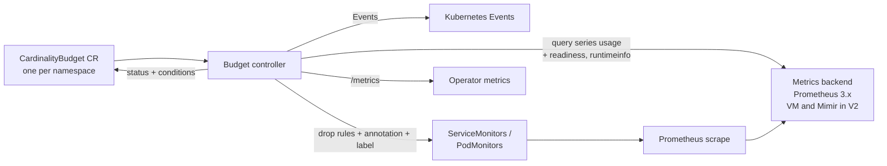
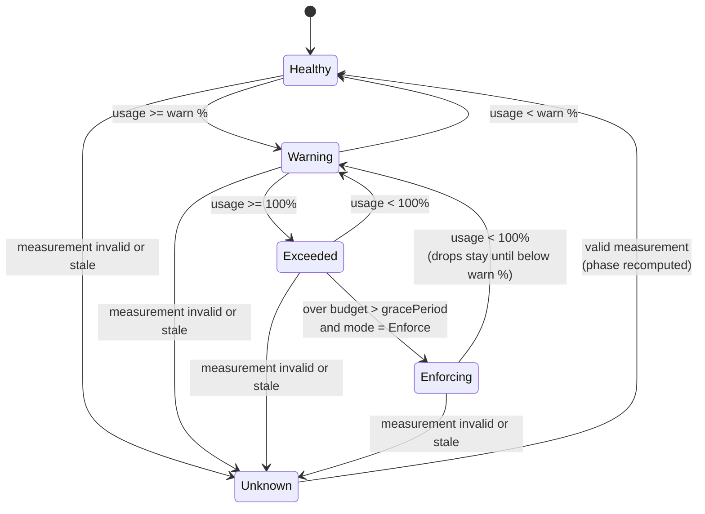

# CardinalityBudget Operator — High Level Design

2026-09-25 · Machani Vidyasagar · Updated 2026-10-12 (decisions in [ADR 0001–0014](../adr/README.md))

## Purpose and positioning

CardinalityBudget is a Kubernetes policy operator. It gives each namespace a metric-series budget, reports usage on the resource itself, and enforces the budget gradually through limiters that already exist.

**Problem.** One team's cardinality spike can degrade monitoring for every team sharing the same Prometheus or VictoriaMetrics instance. Today's controls are hard cutoffs, set centrally by platform admins, each in its backend's own format:

- Prometheus `sample_limit` and the Prometheus Operator's `sampleLimit` / `enforcedSampleLimit`: exceeding the limit fails the whole scrape.
- vmagent series limits (global or per target): excess series are dropped in arrival order.
- Mimir per-tenant series limits: excess writes are rejected, and the limits live in a backend override file.

**Positioning.** CardinalityBudget is a control plane over these data-plane limiters. It measures, reports and drives limits; it never drops samples itself. The platform team sets budgets; teams see their budget and its status through Kubernetes RBAC ([ADR 0002](../adr/0002-budget-ownership-and-rbac.md)).

## Goals and non-goals

The operator makes metric-series usage visible and bounded per namespace, without replacing any part of the monitoring stack.

**Goals**

- A namespace-scoped budget that teams can read with `kubectl get cardinalitybudget`.
- Graduated response: Observe, then Warn, then Enforce, never an immediate cutoff.
- Surgical enforcement: drop the top offending metrics and keep the rest.
- Backend-agnostic measurement behind a small interface.
- Production grade from the first stable release (v1.0): HA, fail-safe enforcement, least-privilege security, tested upgrades. The build also serves as a deep learning path for controller-runtime.

**Non-goals**

- Implementing a sample limiter or proxy in the data path.
- Cost attribution or chargeback reporting.
- Log, trace or profile budgets (candidate for a later release, see Idea log).
- Managing Prometheus, VictoriaMetrics or Mimir installations.
- Letting teams edit their own budget in V1 ([ADR 0002](../adr/0002-budget-ownership-and-rbac.md)).

## Architecture overview

One controller reconciles CardinalityBudget objects, reads usage from a metrics backend, and writes enforcement into existing resources.



The loop closes through the backend: enforcement changes scrape config, which lowers the usage the controller measures next. That loop has a delay of several minutes, which the settle period accounts for ([ADR 0006](../adr/0006-enforcement-safety.md)).

| Component | Responsibility |
| --- | --- |
| Budget controller | Reconciles each CardinalityBudget; owns mode transitions, status, pause and resume |
| Usage provider | Interface over backend APIs; returns series per namespace and top metrics, and decides whether a measurement is valid ([ADR 0005](../adr/0005-measurement-validity-and-backend-access.md)) |
| Enforcer | Adds and removes drop rules on ServiceMonitors / PodMonitors with read-modify-write and optimistic locking; records ownership in an annotation; detects drift ([ADR 0007](../adr/0007-drop-rule-ownership-and-write-strategy.md), [ADR 0008](../adr/0008-drift-pause-and-resume.md)) |
| Spec validation | Rejects invalid specs: CEL rules in V1, a webhook in V2 |
| Metrics and Events | One gauge series per budget plus cluster-wide safety gauges; one Event per state change |

## API design

The API is one namespaced kind, `CardinalityBudget`, starting at `v1alpha1`, in the API group `cardinality.telemetry-compass.com`. Each namespace has at most one budget, and it must be named `default` ([ADR 0004](../adr/0004-one-budget-per-namespace.md)).

```yaml
apiVersion: cardinality.telemetry-compass.com/v1alpha1
kind: CardinalityBudget
metadata:
  name: default            # required name, one budget per namespace
  namespace: payments
  annotations:
    # set by the platform to resume a paused budget (ADR 0008)
    cardinality.telemetry-compass.com/resume-enforcement: "2026-10-04T12:00:00Z"
spec:
  maxActiveSeries: 50000
  warnThresholdPercent: 80
  mode: Enforce            # Observe | Warn | Enforce (default Observe)
  enforcement:
    gracePeriod: 30m       # time over budget before the first drop
    maxMetricsToDrop: 3    # drop at most N metrics per step (1-10)
    maxTotalDrops: 5       # drop at most N metrics in total (1-10, default 5)
    protectedMetrics:      # never dropped (regex)
      - "^up$"
      - "^slo_.*"
    monitorSelector: {}    # which ServiceMonitors/PodMonitors to patch; empty = all in namespace
status:
  observedGeneration: 3
  phase: Enforcing         # Healthy | Warning | Exceeded | Enforcing | Unknown
  activeSeries: 61230
  usagePercent: 122
  lastMeasured: "2026-09-25T10:15:00Z"
  exceededSince: "2026-09-25T09:40:00Z"
  lastEnforcementTime: "2026-09-25T10:45:00Z"
  lastResumeToken: "2026-10-04T12:00:00Z"
  topMetrics:              # capped at 10 entries
    - name: http_request_duration_seconds_bucket
      series: 18400
  plannedDrops:            # Warn and Enforce: what the next step would drop
    - http_requests_total
  enforcedDrops:           # one entry per metric, capped at 10 entries
    - metric: http_request_duration_seconds_bucket
      monitorCount: 4
      since: "2026-09-25T10:45:00Z"
      state: Effective     # Pending | Effective | Ineffective | Reverted
  conditions:
    - type: Ready
      status: "True"
      reason: MeasurementValid
    - type: BackendReachable
      status: "True"
    - type: BudgetExceeded
      status: "True"
    - type: Enforced
      status: "True"
      reason: Applied
```

| Field | Purpose |
| --- | --- |
| `mode` | Chooses how far the operator may act; budgets start at Observe |
| `gracePeriod` | Avoids enforcing on short spikes such as a rollout |
| `maxMetricsToDrop` / `maxTotalDrops` | Caps each step and the total; CEL requires `maxMetricsToDrop <= maxTotalDrops` ([ADR 0006](../adr/0006-enforcement-safety.md)) |
| `protectedMetrics` | Keeps SLO and health metrics safe from drop rules; fully anchored RE2 patterns, an invalid pattern freezes the budget ([ADR 0012](../adr/0012-protected-metrics-validation.md)) |
| `topMetrics` | Tells the team what to fix; capped to keep the object small in etcd |
| `plannedDrops` | Dry run: what Enforce would drop next |
| `enforcedDrops` | Records exactly what the operator changed, one entry per metric; per-monitor detail is in monitor annotations and Events ([ADR 0007](../adr/0007-drop-rule-ownership-and-write-strategy.md)) |
| `lastEnforcementTime` | Start of the settle period after any apply or restore ([ADR 0006](../adr/0006-enforcement-safety.md)) |
| `lastResumeToken` | Last resume annotation value acted on ([ADR 0008](../adr/0008-drift-pause-and-resume.md)) |

**Conditions**

| Type | Meaning | Reasons |
| --- | --- | --- |
| `Ready` | Last reconcile succeeded, the spec is usable, and the measurement is valid and fresh | `MeasurementValid`; `InvalidSpec`, `BackendUnreachable`, `BackendWarmingUp`, `PartialData`, `Stale` |
| `BackendReachable` | The backend answered and is ready | |
| `BudgetExceeded` | Usage is at or above 100% | |
| `Enforced` | Drop rules are applied and enforcement may continue | `Applied`; `Ineffective`, `LimitReached`, `ConfigReloadFailed`, `Reverted`, `RateLimited`, `Paused` |

`Ineffective`, `ConfigReloadFailed` and `Reverted` pause the budget until the platform resumes it ([ADR 0008](../adr/0008-drift-pause-and-resume.md)). `RateLimited` clears on its own. `Paused` reflects the global kill switch.

**Defaults** ([ADR 0014](../adr/0014-spec-defaults.md)): `warnThresholdPercent: 90`, `mode: Observe`, `gracePeriod: 30m`, `maxMetricsToDrop: 1`, `maxTotalDrops: 5`; `maxActiveSeries` is required. The example above uses illustrative values.

**Validation (CEL):** name is `default`; `maxActiveSeries > 0`; `warnThresholdPercent` 1-99; `maxMetricsToDrop` and `maxTotalDrops` 1-10; `maxMetricsToDrop <= maxTotalDrops`; `protectedMetrics` at most 64 items of 1-256 characters, and valid regexes where CEL supports the check. The operator also checks the patterns at runtime ([ADR 0012](../adr/0012-protected-metrics-validation.md)).

Printer columns for `kubectl get`: Phase, Series, Limit, Usage %, Mode, Age.

**Marks on monitors** ([ADR 0007](../adr/0007-drop-rule-ownership-and-write-strategy.md))

- Annotation `cardinality.telemetry-compass.com/dropped-metrics`: JSON list of the metrics whose drop rules the operator owns on this monitor.
- Label `cardinality.telemetry-compass.com/enforced: "true"`: finds every modified monitor in the cluster.

## Reconcile loop

Each reconcile measures, decides a phase, keeps existing drops correct, acts according to mode, writes status, and requeues, because usage changes without any Kubernetes event.

1. **Fetch** the CardinalityBudget. If it is being deleted, remove every owned drop rule from every monitor, then remove the finalizer `cardinality.telemetry-compass.com/cleanup` (blocked while the kill switch is on). Otherwise ensure the finalizer is present.
2. **Resume**: if the resume annotation differs from `status.lastResumeToken`, clear the pause, remove `Reverted` entries, record the token.
3. **Measure** through the usage provider: active series and the top 10 metrics for the namespace, excluding cluster exporters ([ADR 0003](../adr/0003-series-attribution.md)). If the measurement is not valid or not fresh: phase `Unknown`, `Ready=False`, **no drop rules added or removed**, write status, requeue ([ADR 0005](../adr/0005-measurement-validity-and-backend-access.md)). If any `protectedMetrics` pattern does not compile: `Ready=False` with `InvalidSpec`, empty `plannedDrops`, no drop rules added or removed; the phase and usage still update ([ADR 0012](../adr/0012-protected-metrics-validation.md)).
4. **Compute** usage percent and the phase; set `exceededSince` when usage first reaches 100%, clear it when usage falls below.
5. **Maintain existing drops** ([ADR 0006](../adr/0006-enforcement-safety.md), [ADR 0008](../adr/0008-drift-pause-and-resume.md), [ADR 0009](../adr/0009-spec-changes-and-restore-order.md)):
   - check that Prometheus reloaded after the last change; if not within 5 minutes, pause with `ConfigReloadFailed`;
   - after the settle period, mark each `Pending` drop `Effective` or `Ineffective` (90% rule);
   - detect drift (`Reverted`); extend drops to new or newly selected monitors; remove owned rules from deselected monitors;
   - restore any dropped metric that is now protected, immediately.
6. **Act by mode**:
   - Observe: status only.
   - Warn: also Events and `plannedDrops`.
   - Enforce: also add drop rules when all hold: `now - exceededSince > gracePeriod`, settle period over, not paused, kill switch off, under `maxTotalDrops` and the hourly limit. Up to `maxMetricsToDrop` metrics per step, skipping protected metrics and names containing `:`.
   - Leaving Enforce: restore all drops gradually, whatever the usage.
7. **Restore** when usage is below the warn threshold: one step per settle period, most recent drop first.
8. **Write status** and conditions through the status subresource; requeue after the smaller of the measurement interval (default 5 minutes) and the time left in the settle period, with small random jitter to spread backend load.



In `Unknown` the operator neither adds nor removes drop rules; it never acts on missing, partial or stale data.

**Enforcement step concurrency** ([ADR 0010](../adr/0010-rate-limit-and-kill-switch.md)): measurement reconciles run in parallel; the step "check limits, apply drops, write status" runs one budget at a time, reading budgets directly from the API server.

## Safety rules

Enforce mode deletes data, so these rules override every feature.

| Rule | Source |
| --- | --- |
| Default mode is Observe | [ADR 0002](../adr/0002-budget-ownership-and-rbac.md) |
| Only the platform team writes budgets | [ADR 0002](../adr/0002-budget-ownership-and-rbac.md) |
| Enforce mode requires Prometheus `enforcedNamespaceLabel` | [ADR 0003](../adr/0003-series-attribution.md) |
| No drops added or removed on an invalid or stale measurement | [ADR 0005](../adr/0005-measurement-validity-and-backend-access.md) |
| No drops added or removed while a `protectedMetrics` pattern is invalid | [ADR 0012](../adr/0012-protected-metrics-validation.md) |
| Never drop a protected metric or a recording-rule name; never exceed `maxMetricsToDrop` per step or `maxTotalDrops` in total | [ADR 0006](../adr/0006-enforcement-safety.md) |
| Wait a settle period between steps; stop if Prometheus fails to reload; stop if a drop is ineffective | [ADR 0006](../adr/0006-enforcement-safety.md) |
| Never remove or reorder the team's own relabel rules | [ADR 0007](../adr/0007-drop-rule-ownership-and-write-strategy.md) |
| Never re-apply a reverted drop; pause until a person resumes | [ADR 0008](../adr/0008-drift-pause-and-resume.md) |
| Global hourly drop limit; global kill switch blocks every monitor write | [ADR 0010](../adr/0010-rate-limit-and-kill-switch.md) |
| Every drop is recorded in `enforcedDrops`, in an Event, and in an annotation and label on the monitor | [ADR 0007](../adr/0007-drop-rule-ownership-and-write-strategy.md) |

## Operator configuration

Cluster-wide settings are operator flags, set by the platform team.

| Flag | Default | Purpose |
| --- | --- | --- |
| `--prometheus-url` | (required) | Backend URL |
| `--prometheus-http-config` | (none) | Prometheus-format HTTP client config file: auth, TLS, proxy ([ADR 0005](../adr/0005-measurement-validity-and-backend-access.md)) |
| `--namespace-label` | `namespace` | Label that attributes a series to a namespace ([ADR 0003](../adr/0003-series-attribution.md)) |
| `--exclude-series` | `job!~"apiserver\|coredns\|kube-state-metrics\|kubelet\|node-exporter",job!=""` | PromQL matchers excluding cluster exporters and recording-rule outputs ([ADR 0003](../adr/0003-series-attribution.md), [ADR 0013](../adr/0013-default-series-exclusion.md)) |
| `--measure-interval` | `5m` | Time between measurements |
| `--query-timeout` | `30s` | Timeout per backend query |
| `--backend-warmup` | `15m` | Minimum Prometheus uptime before a measurement is valid |
| `--max-measurement-age` | `2 x measure-interval` | Age after which a measurement is stale |
| `--enforcement-settle-period` | `10m` | Wait between enforcement steps ([ADR 0006](../adr/0006-enforcement-safety.md)) |
| `--max-drops-per-hour` | `10` | Global drop rate limit ([ADR 0010](../adr/0010-rate-limit-and-kill-switch.md)) |
| `--enforcement-paused` | `false` | Global kill switch ([ADR 0010](../adr/0010-rate-limit-and-kill-switch.md)) |

Invalid `--exclude-series` or `--prometheus-http-config` stops the operator at startup. Credentials are only ever files mounted from Secrets.

## V1 scope: one backend, full loop

V1 delivers the complete measure-warn-enforce-undo loop against Prometheus 3.x only, through its native HTTP API (VictoriaMetrics support follows in V2), with enforcement only through ServiceMonitor and PodMonitor drop rules.

| Feature | What it does | Controller concept it teaches |
| --- | --- | --- |
| CRD `v1alpha1` | Spec, status subresource, printer columns | CRD schema generation with controller-gen |
| Spec validation | CEL rules: required name, ranges, `maxMetricsToDrop <= maxTotalDrops` | `x-kubernetes-validations` without a webhook |
| Usage provider (Prometheus native) | Series per namespace and top 10 metrics via PromQL scoped to the namespace, excluding cluster exporters; validity checks via `/-/ready` and `/api/v1/status/runtimeinfo`; backend URL and auth config set on the operator | Reconciling against state outside etcd |
| Modes Observe / Warn / Enforce | Graduated response per budget | Mode-driven branching in one reconciler |
| Planned drops in Warn mode | Status lists what Enforce would drop, as a dry run | Status as a communication channel |
| Drop-rule enforcement | Adds `metricRelabelings` drop rules to selected monitors; honours `maxMetricsToDrop`, `maxTotalDrops`, `protectedMetrics`, `gracePeriod` and the settle period | Patching another controller's resources with read-modify-write and optimistic locking |
| Effectiveness and reload checks | Confirms Prometheus reloaded and that each drop removed the series | Verifying the effect of an action in a closed loop |
| Drift detection, pause and resume | Detects reverted drops, pauses, resumes on a platform annotation | Level-triggered handling of external changes |
| Undo and cleanup | Removes drop rules when usage recovers, the spec relaxes, or the CR is deleted | Finalizers and idempotent reversal |
| Global safety controls | Hourly drop limit and kill switch | Coordinating across objects without in-memory state |
| Status and conditions | Phase, usage, top metrics, planned and enforced drops; conditions Ready, BackendReachable, BudgetExceeded, Enforced | `metav1.Condition` and observedGeneration |
| Periodic requeue | Re-measure every 5 minutes by default | `RequeueAfter` for time-driven work |
| Events | One Event per state change | EventRecorder |
| Operator metrics | Per-budget gauges: series, limit, usage ratio, drops active; cluster gauges such as enforcement paused | controller-runtime metrics registry |
| Install and demo | Kustomize install; kind cluster with a synthetic high-cardinality app | envtest unit tests plus an end-to-end demo |

## V2 scope: many backends, smarter enforcement, GitOps-safe

V2 makes the operator production-shaped: pluggable backends and enforcement targets, finer-grained enforcement, cluster-wide defaults, and smoother coexistence with Argo CD and Flux.

| Feature | What it does | Controller concept it teaches |
| --- | --- | --- |
| `BackendConfig` kind (cluster-scoped) | Budgets reference a named backend; supports several backends in one cluster | Cross-resource references and watches |
| More usage providers | VictoriaMetrics first (native TSDB status API), then Mimir cardinality API | Interface design and provider plugins |
| More enforcement targets | vmagent `VMServiceScrape` rules, `sampleLimit` as a safety net, Mimir per-tenant overrides | One policy driving several data planes |
| Label-level enforcement | Finds the exploding label (e.g. `user_id`) and drops only that label, not the metric | Deeper analysis before acting |
| GitOps coexistence | Builds on V1 drift detection ([ADR 0008](../adr/0008-drift-pause-and-resume.md)): field-manager awareness, recognising which tool reverted a drop, smarter handling than pause | Field managers and conflict handling |
| Hysteresis and staged restore | Restores dropped metrics one at a time after a stable period below the threshold | Avoiding flapping control loops |
| Churn budget | Limits new series per hour, not only active series | A second measured dimension |
| Exhaustion forecast | Status shows projected time to budget exhaustion | Trend queries in the provider |
| Cluster defaults | `ClusterCardinalityBudget` applies a default budget to namespaces by label selector | Cluster-scoped policy with namespaced overrides |
| Generated alerts | A PrometheusRule per budget for Warn and Exceeded | Owned child resources and garbage collection |
| API `v1beta1` | Pulled into v1.0 (see Production readiness). Conversion webhook from `v1alpha1`; validating webhook for cross-field rules | API versioning and webhooks |

## Production readiness

The V1 feature set ships as production grade at v1.0; releases before it (v0.x) are alpha and run only on the lab cluster. Production grade here means the operator is safe to leave running unattended, because Enforce mode deletes data.

| Area | Bar for v1.0 |
| --- | --- |
| Availability | 2 replicas with leader election, PodDisruptionBudget, pod anti-affinity; all state kept in status and on monitors, so a restart resumes cleanly |
| Fail-safe enforcement | Every rule in Safety rules, each covered by tests |
| Auditability | Every drop recorded in `enforcedDrops`, as an Event, and as an annotation and label on the monitor, so it can be found and removed by hand |
| Security | Least-privilege RBAC; teams read-only; credentials only from mounted files; non-root, read-only root filesystem, seccomp RuntimeDefault; NetworkPolicy; authenticated metrics endpoint; signed images, SBOM, vulnerability scan in CI |
| API stability | API `v1beta1` with a conversion webhook from `v1alpha1` (pulled forward from V2); documented deprecation policy |
| Upgrades | Helm chart with CRDs upgraded explicitly (Helm does not upgrade CRDs in its `crds/` folder); semantic versioning; tested upgrade from the previous minor release |
| Testing | Unit tests, envtest integration tests, end-to-end tests on kind in CI, failure tests (backend down, leader failover mid-step, reverts), and scale tests on the hardware cluster |
| Compatibility | Published matrix following the support policy below |
| Operator observability | Metrics, a Grafana dashboard, and alert rules for the operator itself (reconcile errors, backend unreachable, kill switch active, budget paused, config reload failed) |
| Documentation | Install guide, user guide, admin guide, GitOps guide, runbook for each alert, uninstall procedure, CHANGELOG, security policy |

**Version support policy** ([ADR 0011](../adr/0011-version-support-policy.md))

| System | Supported |
| --- | --- |
| Kubernetes | The three minors under upstream support at each release |
| Prometheus Operator | Releases from about the last 12 months that have every required feature |
| Prometheus | 3.x only, including the current LTS |
| Images | `linux/amd64`, `linux/arm64` |

CI is the source of truth for the matrix. Exact minimum versions are set in Phase 1 and the full matrix is required from v0.3.

**Milestones**

| Release | Scope | Where it runs |
| --- | --- | --- |
| v0.1 | CRD, usage provider, Observe and Warn modes | Lab cluster |
| v0.2 | Enforce mode, undo, finalizers, drift detection, pause and resume, kill switch (Enforce never ships without it) | Lab cluster |
| v0.3 | Hardening: HA, security, rate limit, Helm chart, CI matrix, scale tests | Hardware cluster |
| v1.0 | Production readiness bar met; `v1beta1` API | Production |
| v2.x | V2 features, VictoriaMetrics first | Production |

**Scale-test environment on the hardware cluster**

- Multi-node cluster with kube-prometheus-stack as the monitored system.
- A synthetic load generator producing high-cardinality metrics across many namespaces.
- Target numbers still to set: budgets per cluster, total active series in Prometheus, and the maximum acceptable reconcile latency and backend query load.

## Decision records

Design decisions and the alternatives considered are recorded in [docs/adr](../adr/README.md). Any change to behaviour or the API in this document links to an ADR.

## Idea log

Every new idea lands here first with a target release; once accepted, it moves into the V1 or V2 table above and its status becomes Accepted. Add a row per idea, newest first.

| Date | Idea | Release | Status |
| --- | --- | --- | --- |
| 2026-10-04 | Kill switch through a watched ConfigMap instead of a flag (no rollout needed) | Backlog | Proposed |
| 2026-10-04 | Report excluded infrastructure series in `status.infrastructureSeries` | Backlog | Proposed |
| 2026-10-04 | Operator checks the Prometheus CR for `enforcedNamespaceLabel` and warns if missing | Backlog | Proposed |
| 2026-10-04 | Self-service budgets: teams edit within platform limits via ValidatingAdmissionPolicy | Backlog | Proposed |
| 2026-09-25 | Warn mode lists planned drops in status as a dry run | V1 | Accepted |
| 2026-09-25 | Ship a Grafana dashboard for budgets with the operator | V1 | Accepted |
| 2026-09-25 | Share the Prometheus/Alertmanager client package with future AlertCanary and MonitoringCoverage operators | V2 | Proposed |
| 2026-09-25 | GitOps-native enforcement: open a pull request with suggested drop rules instead of patching live resources | Backlog | Proposed |
| 2026-09-25 | Log budgets: Loki stream count and ingestion volume per namespace | Backlog | Proposed |

## Risks and open questions

The biggest risk is acting on wrong data or against GitOps; the design answers both by refusing to act when unsure and pausing for a person.

| Risk | Mitigation |
| --- | --- |
| Argo CD or Flux reverts drop rules, causing a patch loop | V1 detects reverts, never re-applies, pauses the budget; GitOps guide documents `ignoreDifferences` and Flux options ([ADR 0008](../adr/0008-drift-pause-and-resume.md)) |
| Dropping a metric that dashboards or alerts depend on | `protectedMetrics`, `maxMetricsToDrop`, `maxTotalDrops`, grace period, Warn-mode dry run |
| A monitor excluded from `enforcedNamespaceLabel` (e.g. the API server, in `default`) counts against its targets' namespace | Default `--exclude-series` covers the kube-prometheus-stack jobs; documented rule: every excluded monitor's job must be in the flag ([ADR 0013](../adr/0013-default-series-exclusion.md)) |
| A team spoofs another namespace's label and triggers drops on its monitors | `enforcedNamespaceLabel` required for Enforce mode ([ADR 0003](../adr/0003-series-attribution.md)) |
| Falsely low counts after a Prometheus restart trigger restores | Validity checks block both drops and restores ([ADR 0005](../adr/0005-measurement-validity-and-backend-access.md)) |
| Over-dropping because the effect of a drop takes minutes to appear | Settle period tracked in status ([ADR 0006](../adr/0006-enforcement-safety.md)) |
| A drop rule breaks the Prometheus config | Reload check pauses the budget and alerts ([ADR 0006](../adr/0006-enforcement-safety.md)) |
| Drops that cannot reduce usage (recording rules, other sources) | Name filter, effectiveness check, total cap ([ADR 0006](../adr/0006-enforcement-safety.md)) |
| Expensive usage queries on large backends | Per-namespace `count()` with exporter exclusion, query timeout, requeue jitter; TSDB head stats are unsuitable for verification because they lag 2-3 hours; scale tests decide whether the cost is acceptable |
| Status object grows too large | Cap `topMetrics` and `enforcedDrops` lists; one `enforcedDrops` entry per metric |
| Flapping between Enforcing and Healthy | Restore only below the warn threshold, one step per settle period; hysteresis in V2 |
| Operator removed before its budgets leaves finalizers stuck | Documented uninstall order and a stuck-finalizer runbook |

**Open questions**

- [x] Which label identifies a series' namespace: the `namespace` label (configurable), trusted for Enforce only with `enforcedNamespaceLabel` ([ADR 0003](../adr/0003-series-attribution.md)), decided 2026-10-04.
- [x] How series from cluster-wide exporters are counted: excluded by a cluster-wide selector ([ADR 0003](../adr/0003-series-attribution.md)), decided 2026-10-04.
- [x] More than one CardinalityBudget per namespace: no, the name must be `default` ([ADR 0004](../adr/0004-one-budget-per-namespace.md)), decided 2026-10-04.
- [x] API group domain for the CRD: `cardinality.telemetry-compass.com` (decided 2026-09-27).
- [ ] Scale-test targets: budgets per cluster, total series, reconcile latency, query load (before v0.3).
