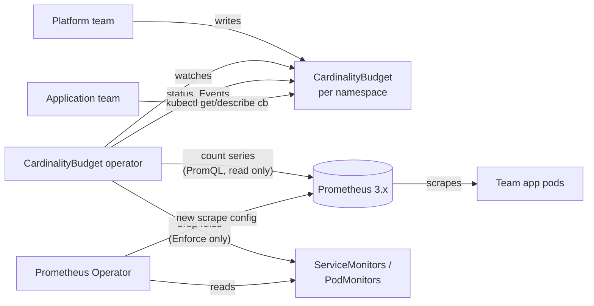
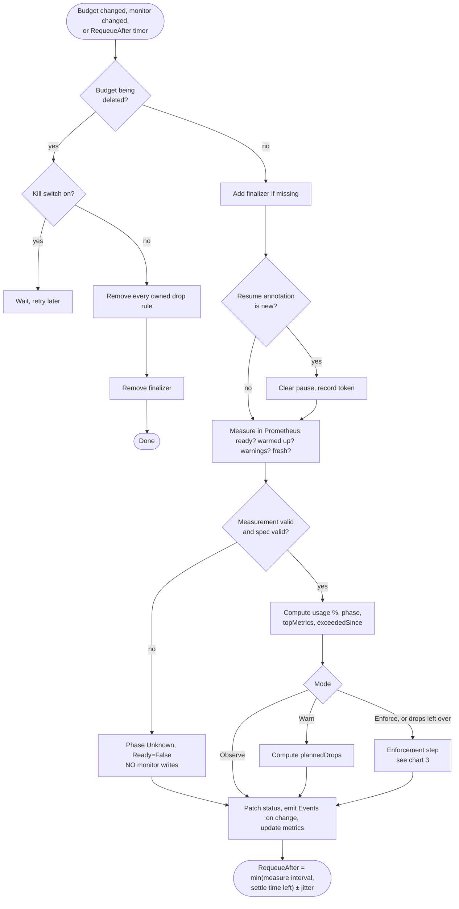
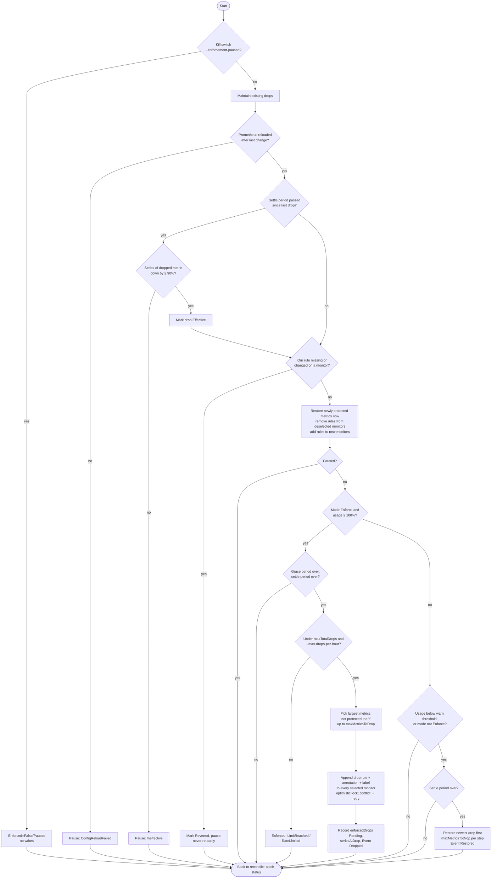
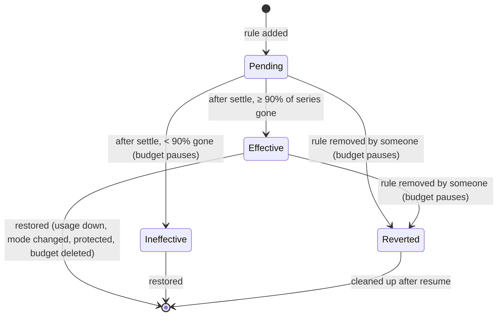
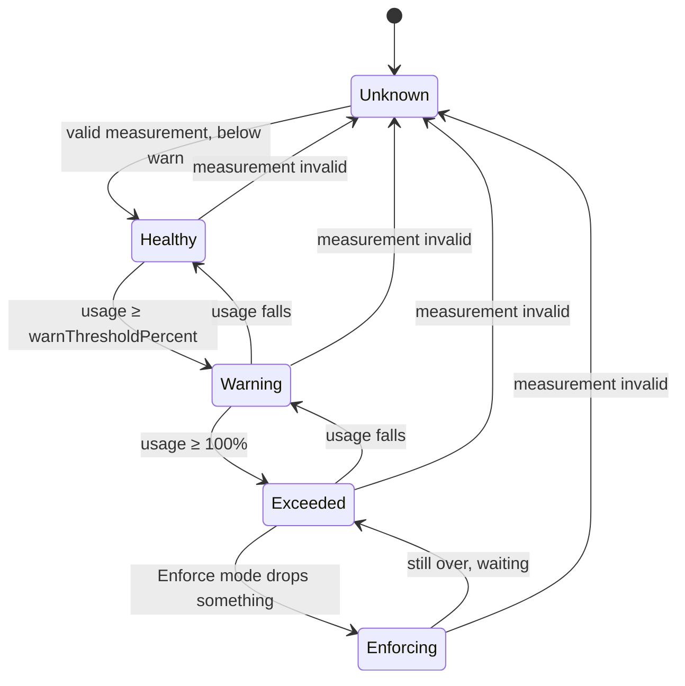

# How CardinalityBudget works

Mermaid diagrams. They render on GitHub and in VS Code (Markdown Preview Mermaid Support).

## 1. Big picture

## 2. One reconcile

## 3. Enforcement step (under a mutex, fresh read of the budget)

## 4. Life of one drop

## 5. Phases

